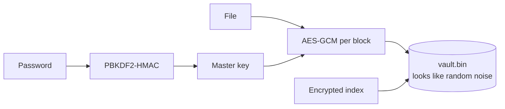

<div align="center">

# 👻 Zero-Trace FS — Phantom Vault

### A deniable encrypted vault where stored data is indistinguishable from random noise


[](LICENSE)    

[](https://codespaces.new/shiroonigami23-ui/Zero-Trace-FS?quickstart=1) [](https://github.com/shiroonigami23-ui/Zero-Trace-FS/archive/refs/heads/main.zip)

[**Overview**](#-overview) · [**Features**](#-features) · [**Architecture**](#-architecture) · [**Getting Started**](#-getting-started) · [**Roadmap**](#-roadmap)

</div>

---

## 📖 Overview

**Zero-Trace FS** is a research prototype of a **deniable storage vault**. A `vault.bin` file is filled with random bytes; files are encrypted with **AES-GCM** under a key derived by **PBKDF2-HMAC** from your password and written into fixed-size blocks, so the vault looks like pure noise whether it holds data or not. An indexer tracks which blocks belong to which file.

### ✨ Highlights

- **Indistinguishable from noise** — no headers, no visible structure
- **AES-GCM** authenticated encryption
- **PBKDF2-HMAC** key derivation
- **Block-level** storage engine

## 🧩 Features

| Feature | What it does |
|---|---|
| **Vault initialisation** | Create an N-MB random `vault.bin` |
| **Key derivation** | Password → master key with PBKDF2-HMAC |
| **Block engine** | Encrypt/decrypt fixed-size blocks (`core/engine.py`) |
| **Indexer** | Map files to block positions (`core/indexer.py`) |
| **App** | `app.py` entry point |

## 🛠 Tech Stack

| Layer | Technology |
|---|---|
| Language | Python |
| Crypto | `cryptography` (AESGCM, PBKDF2HMAC) |

## 🏗 Architecture




➡️ Full design notes, data flow and design decisions: **[docs/ARCHITECTURE.md](docs/ARCHITECTURE.md)**

## 📁 Project Structure

```text
Zero-Trace-FS/
├── app.py
└── core/{engine.py, indexer.py}
```

## 🚀 Getting Started

### 1. Get the code

Pick whichever method suits you:

| Method | Command |
|---|---|
| **HTTPS** | `git clone https://github.com/shiroonigami23-ui/Zero-Trace-FS.git` |
| **SSH** | `git clone git@github.com:shiroonigami23-ui/Zero-Trace-FS.git` |
| **GitHub CLI** | `gh repo clone shiroonigami23-ui/Zero-Trace-FS` |
| **ZIP** | [Download](https://github.com/shiroonigami23-ui/Zero-Trace-FS/archive/refs/heads/main.zip) and extract |
| **Codespaces** | [Open in browser](https://codespaces.new/shiroonigami23-ui/Zero-Trace-FS?quickstart=1) — zero local setup, dev container preconfigured |

> 🔑 **Using SSH for the first time?** Generate a key with `ssh-keygen -t ed25519 -C "you@example.com"`, add the `.pub` contents at **GitHub → Settings → SSH and GPG keys**, then test with `ssh -T git@github.com`.

### 2. Install & set up

```bash
cd Zero-Trace-FS
pip install cryptography
```

### 3. Run

```python
from core.engine import ZeroTraceEngine
ztfs = ZeroTraceEngine()
ztfs.initialize_vault(size_mb=10)
```
The project was developed in Google Colab; run the same cells locally.

## 🗺 Roadmap

**v0.1 — Foundation (done)**

- [x] Random vault init, key derivation, engine & indexer skeleton

**v0.2**

- [ ] Store/retrieve files end-to-end with an encrypted index
- [ ] Hidden volumes (two passwords, two vaults in one file)
- [ ] CLI: `ztfs put/get/ls`

**v1.0**

- [ ] FUSE mount
- [ ] Argon2id KDF
- [ ] Security review and tests

➡️ Detailed plan, milestones and long-term vision: **[docs/ROADMAP.md](docs/ROADMAP.md)**

## 🤝 Contributing

Contributions, issues and feature requests are welcome!

1. Fork the repository
2. Create a feature branch: `git checkout -b feature/amazing-feature`
3. Commit your changes: `git commit -m "feat: add amazing feature"`
4. Push the branch: `git push origin feature/amazing-feature`
5. Open a Pull Request against `main`

Check the [issues page](https://github.com/shiroonigami23-ui/Zero-Trace-FS/issues) and the [roadmap](docs/ROADMAP.md) for ideas on where to help.

## 📜 Changelog

See [CHANGELOG.md](CHANGELOG.md) for the release history.

## 📄 License

Distributed under the **MIT** license. See [LICENSE](LICENSE) for details.

## 👤 Author

**Aryan Singh Chandel** (Shiro)

[](https://github.com/shiroonigami23-ui)

<div align="center">

⭐ **If you find this project useful, consider giving it a star!** ⭐

</div>
