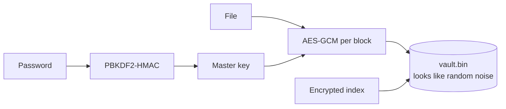

# 🏗 Architecture — Zero-Trace FS — Phantom Vault

> Part of [Zero-Trace-FS](https://github.com/shiroonigami23-ui/Zero-Trace-FS). Back to the [README](../README.md).

## 1. System Overview

The engine treats the vault as an array of blocks; every write fills a block with AES-GCM ciphertext so used and unused blocks look the same. The indexer (itself encrypted) records block ownership.

## 2. Components

| Component | Location | Responsibility |
|---|---|---|
| **Engine** | `core/engine.py` | Vault, KDF, block crypto |
| **Indexer** | `core/indexer.py` | File → blocks map |

## 3. Data / Control Flow

1. Initialise vault with random data.
2. Derive key from password.
3. Encrypt file chunks into free blocks; update index.

## 4. Key Design Decisions

| Decision | Rationale |
|---|---|
| Random fill | Hides how much data is stored |

## 5. Known Limitations

- Early prototype — not for real secrets yet

---
*Last updated: 2026-11-13*
